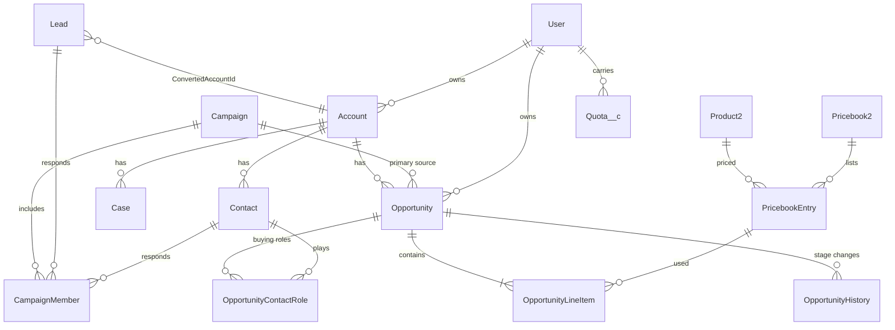

# Tech Summit Data Set: Synthetic Salesforce CRM (FY2021 to FY2025)

This is a large, fake Salesforce CRM dataset for **Altura Cloud Systems**, a made-up B2B software company that sells a cloud platform, add-ons, professional services and edge hardware. It covers **five full fiscal years (Jan 1 2021 to Dec 31 2025)**. Every company, person, email address and phone number in it is made up. US phone numbers use the fictional 555 exchange.

Story behind the data: Altura moved from a legacy CRM into Salesforce on **2021-01-04**, bringing over about 2,000 existing accounts. About 900 of those were paying customers. Over the next five years the company grew about 35–40% a year, from roughly $96M to $352M in ending ARR.

## What's in the folder

```
Tech Summit data set/
├── data/                         one CSV per Salesforce object (UTF-8, header row, Salesforce API field names)
├── salesforce_crm.sqlite         the same 17 tables in SQLite, with primary keys and foreign-key indexes
├── data_summary.md               row counts + yearly KPIs computed from the data
├── scripts/generate_salesforce_data.py   the generator (Python 3 standard library only, fixed seed)
└── README.md
```

**About 1.2 million rows** in total (the CSVs take about 216 MB on disk):

| Object | Rows | What it holds |
|---|---:|---|
| Task | ~467K | Calls, emails and to-dos for SDR lead cadences, deal work, renewals and case follow-ups |
| CampaignMember | ~205K | Lead and contact responses to campaigns: newsletter sends/opens, event attendance |
| OpportunityHistory | ~111K | One row per stage change for every opportunity |
| OpportunityLineItem | ~81K | Products on each deal, with list price, sales price, discount and quantity |
| Contact | ~76K | People at accounts, with title, department and seniority level |
| Lead | ~76K | Inbound and outbound leads. 6,000 converted; the rest are open, nurturing or unqualified |
| Case | ~65K | Support tickets with priority, SLA, resolution hours and CSAT |
| OpportunityContactRole | ~50K | Buying-committee roles on deals |
| Event | ~43K | Meetings: discovery, demos, QBRs, executive briefings |
| Opportunity | ~25K | New business, upsell and renewal deals: won, lost and open |
| Account | 12,000 | Companies: prospects, customers and former customers |
| Quota__c | ~1.1K | Quarterly quotas for each Account Executive, with ramp for new hires |
| User | 374 | The sales, CS, support and marketing org, including hires and departures |
| Campaign | 326 | Tech Summit conferences, world tour, webinars, trade shows, paid and email programs |
| PricebookEntry / Pricebook2 / Product2 | 108 / 4 / 27 | Product catalog and three price lists over time |

## How the tables connect



- **Ids** are 18-character Salesforce-style Ids with the real key prefixes (`001` Account, `003` Contact, `006` Opportunity, `00Q` Lead, `500` Case, `00T` Task, `00U` Event, `701` Campaign, `005` User…). The checksum suffix is valid.
- **Task and Event** link to records in two ways, like real Salesforce. `WhoId` points to a Contact or Lead, and `WhatId` points to an Opportunity, Account or Case. `AccountId` is filled in where the activity relates to an account.
- **Lead conversion** fills in `ConvertedAccountId`, `ConvertedContactId` and `ConvertedOpportunityId`. That first opportunity carries the lead's campaign in `CampaignId`, so you can trace marketing attribution.
- **Dates:** fields named `...Date` hold dates (`2024-03-15`). `CreatedDate` and other datetimes are UTC (`2024-03-15T14:22:10.000Z`). Booleans are `true`/`false`. FiscalYear is the calendar year.
- Custom fields end in `__c`, as in Salesforce. Examples: `ARR__c`, `Health_Score__c`, `Loss_Reason__c`, `CSAT_Score__c`.

## Patterns built into the data

These are deliberate, so analyses and demos turn up real "insights":

- **Growth:** lead volume, new accounts and the sales team all grow about 30% a year. Customers rise from about 1,040 at the end of 2021 to about 3,220 at the end of 2025.
- **Seasonality and quarter-end crunch:** about 40% of won deals are pulled into the last days of a quarter. Q4 is the biggest quarter; July, August and December are slower for new pipeline.
- **Segments:** SMB, Mid-Market and Enterprise have very different deal sizes, sales cycles (Enterprise median about 5 months), discounts, number of contacts per deal and case volumes.
- **Lead source quality:** Customer Referral, Partner Referral and **Tech Summit** leads convert and win far more often than Paid Search or Content Syndication leads.
- **Price increases:** list prices rise 6% in FY2023 and 10% (versus 2021) in FY2025. Each opportunity points at the price book in effect.
- **Product launches:** *AI Insights* launches 2023-06-06 and *Altura Copilot* launches 2024-09-17. Both show up as new add-on attach and upsell waves, and each has a launch campaign. *Legacy Basic* was retired 2022-06-30, and customers on it are migrated to Standard at renewal.
- **Renewals and churn:** contracts are 12, 24 or 36 months. Renewal win rate depends on the account's health score, so low-health accounts churn more. That makes `Health_Score__c` usable for churn analysis. Lost renewals record a churn reason. About 12% of churned logos get a win-back attempt.
- **Win rate improves** over time, from about 28% to 32%. 2022 has a **support strain**: slower resolutions and lower CSAT.
- **Rep turnover:** users have hire and termination dates. Closed deals stay with the rep who closed them, even if that rep has left. Accounts and open deals are reassigned to active reps.
- **Quotas** ramp for new hires (25% → 50% → 75% → 100%) and are weighted toward Q4, so you can calculate attainment.

### Realistic messiness (on purpose)
- About 260 **stale open opportunities** whose close date has already passed (Description says "Close date passed - needs update").
- **Duplicate leads**: about 0.8%, flagged `Is_Duplicate__c = true`.
- **Missing values**: blank phones, industries, titles, employee counts and revenue on some leads, contacts and accounts.
- Opportunities have `Push_Count__c` (how many times the close date was pushed), and lost deals have competitors and loss reasons.

## Using it

- **Excel / Google Sheets:** open any CSV directly. Task.csv (~467K rows) fits within Excel's 1,048,576-row limit.
- **Power BI / Tableau:** load the CSVs, or connect to the SQLite file, and join on the `Id` / `...Id` columns.
- **SQL:** `sqlite3 salesforce_crm.sqlite`, or use DB Browser for SQLite, DBeaver or Python. Table names match object names, so quote `"Case"` because CASE is a SQL keyword.

Example queries:

```sql
-- Bookings by fiscal year and deal type
SELECT FiscalYear, Type, ROUND(SUM(Amount)/1e6,1) AS bookings_m
FROM Opportunity WHERE IsWon='true' GROUP BY 1,2 ORDER BY 1,2;

-- New-business win rate by lead source
SELECT LeadSource, ROUND(100.0*SUM(IsWon='true')/COUNT(*),1) AS win_pct, COUNT(*) AS closed_deals
FROM Opportunity WHERE Type='New Business' AND IsClosed='true' GROUP BY 1 ORDER BY 2 DESC;

-- Tech Summit ROI: pipeline and won revenue sourced by each Tech Summit campaign
SELECT Name, ActualCost, NumberOfOpportunities, AmountWonOpportunities
FROM Campaign WHERE Name LIKE '%Tech Summit%' ORDER BY StartDate;

-- AE quota attainment for 2025
SELECT u.Name, q.Fiscal_Quarter__c, q.Quota_Amount__c,
       (SELECT COALESCE(SUM(o.Amount),0) FROM Opportunity o
         WHERE o.OwnerId=u.Id AND o.IsWon='true' AND o.Type<>'Existing Business - Renewal'
           AND o.CloseDate BETWEEN q.Period_Start__c AND q.Period_End__c) AS closed_won
FROM Quota__c q JOIN "User" u ON u.Id=q.OwnerId WHERE q.Fiscal_Year__c=2025;

-- Churn vs. health score
SELECT CASE WHEN Health_Score__c<50 THEN '<50' WHEN Health_Score__c<70 THEN '50-69' ELSE '70+' END AS health,
       COUNT(*) AS accounts, ROUND(100.0*SUM(Type='Former Customer')/COUNT(*),1) AS churned_pct
FROM Account WHERE Health_Score__c IS NOT NULL GROUP BY 1;
```

## Regenerating

```bash
python3 scripts/generate_salesforce_data.py              # same data every time (fixed seed), ~1 minute
python3 scripts/generate_salesforce_data.py --scale 2    # ~2x the volume
python3 scripts/generate_salesforce_data.py --seed 7     # a different but statistically similar org
python3 scripts/generate_salesforce_data.py --no-sqlite  # CSVs only
```

`data_summary.md` is rewritten on every run with the actual row counts and yearly KPIs.
